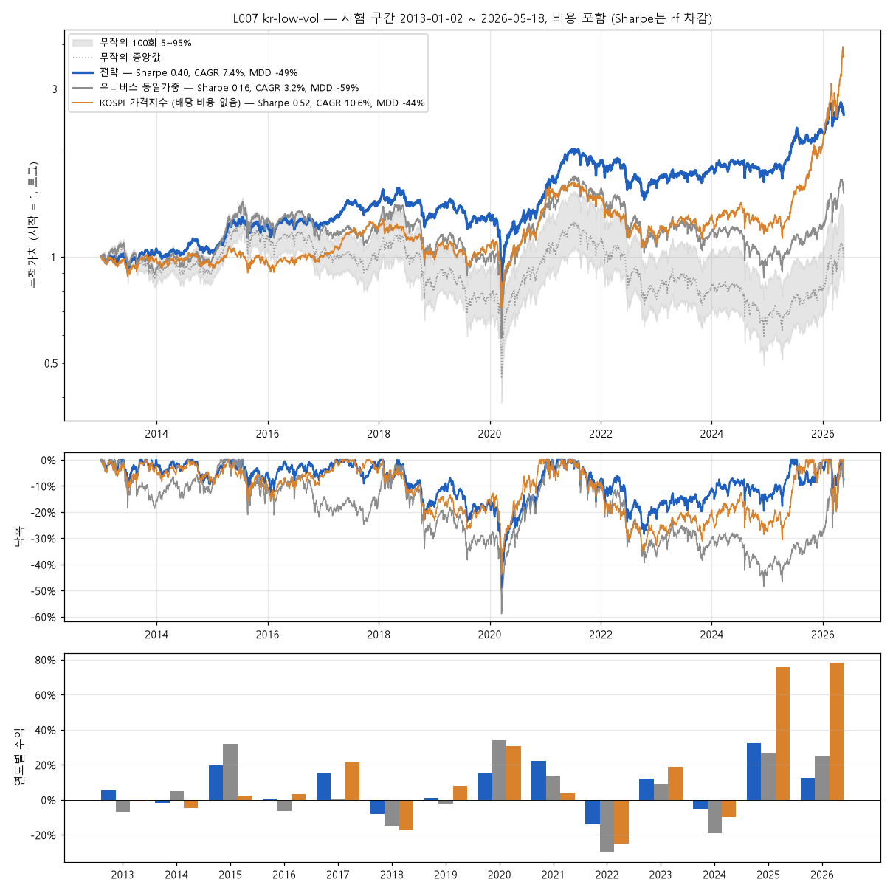

# L007 — KR 저변동성: 252일 변동성 하위 20%

고전 퀀트 프로그램 3번째 기법 ([docs/research/2026-11-18-classic-quant-factors.md](../../docs/research/2026-11-18-classic-quant-factors.md) 5절).
**가설·규칙은 L005·L006 결과를 보기 전에(2026-11-18) 커밋했다.** 아이디어 자체가 L001 판정("복권형 회피")에서 나왔고 같은 KR 개발 구간을 차례로 보므로 `exposed_from: [L001, L005, L006]`.

## 1. 타겟 시장
- 시장 / 유니버스 / 타임프레임: KR 주식 KOSPI+KOSDAQ (상장폐지 포함) / 일봉, 월 1회 리밸런싱
- 유니버스 (프로그램 공통, 사전 고정): 보통주(코드 끝 0), 원본 종가 ≥ 1,000원, 20일 평균 거래대금 ≥ 10억 원, 가격 이력 ≥ 252거래일, 그날 거래(거래량 > 0)
- 이 시장을 고른 이유: 가격만 쓰므로 2010~ 전 구간(상장폐지 포함)을 쓸 수 있다.

## 2. 전략 — 백테스트 실행 전에 작성하고 커밋
- 작성일: 2026-11-18
- **가설**:
  1. 레버리지 제약·복권 선호 때문에 투자자가 고변동 종목을 과대평가하고 저변동 종목을 과소평가한다(Baker, Bradley & Wurgler 2011; Frazzini & Pedersen 2014; Bali, Cakici & Whitelaw 2011). 그래서 변동성 하위 종목의 위험 대비 수익이 더 높다.
  2. 한국은 개인투자자 비중이 높아 복권형 선호가 강하다 (한국 MAX 효과·저변동성 연구, L001에서 모멘텀 상·하위 양 끝이 모두 나빴던 관찰). 저변동 포트폴리오는 **동일가중보다 Sharpe가 높고 MDD가 작을 것**.
  3. 사전 예측: Sharpe는 동일가중·KOSPI보다 높지만 기준 1(1.0)은 못 넘을 것. 2020~21 같은 고변동 주도 상승장에서 크게 뒤처질 것.
- 출처: Blitz & van Vliet (2007, *JPM*) "The volatility effect", Ang, Hodrick, Xing & Zhang (2006, *JF*), Baker, Bradley & Wurgler (2011, *FAJ*), Frazzini & Pedersen (2014, *JFE*)
- 진입 규칙 (매월 첫 거래일 종가 기준 계산, 다음 거래일 시가 체결):
  1. 후보: 공통 유니버스
  2. 점수: 최근 252거래일 일간 수익률(수정주가, 배당 재투자) 표준편차. 거래정지·무거래일 수익률은 빼고, 유효 수익률이 202개(80%) 미만이면 제외
  3. 변동성 하위 20%(후보 수 × 0.2, 내림) 동일가중
- 청산 규칙: 다음 달 첫 거래일에 하위 20% 밖이면 매도. 상장폐지는 엔진이 청산.
- 실행 유형: portfolio, `rebalance: on_signal`
- 파라미터: vol_days 252 (Blitz & van Vliet는 3년 주간을 쓰고 1년도 비슷하다고 보고 — 이력이 짧은 종목을 덜 빼려고 1년), quantile 0.2, 나머지 공통값
- 원 논문과의 차이: 총변동성(Blitz & van Vliet) 기준, 고유변동성(AHXZ)·베타(BAB)는 쓰지 않음. 롱 온리, 레버리지 없음.
- 사전에 정한 비교 (`baseline.py`): KOSPI 지수(참고) / 유니버스 동일가중 / 무작위 같은 종목 수 100회
- 워크포워드: 2011-01-01 시작, 학습 24개월 / 시험 6개월 → 시험 2013-01 ~ 2026-05 (L001과 같은 구간)

## 3. 백테스트 (워크포워드)
- 실행: 2026-11-18 20:50, 결과 `results/20261118-205041/` (git 제외). trials 1, exposed_from [L001, L005, L006]
- 시험 구간: 2013-01-02 ~ 2026-05-15 (3,282봉), 잠금 구간 안 봄
- 비용: 포함 — 수수료 0.015% + 슬리피지 0.05%(한쪽), 매도세 연도별, 배당 재투자(세후). 시장 충격·현금 이자 미반영
- 생존편향: 없음 (krx_1d 상장폐지 포함). 미래참조 자동 검사 통과

- 아래 표는 **2026-11-19 새 엔진 재계산 값** (`results/20261119-193653/`, 기준 1·2·3 모두 rf 차감). 첫 실행 값과 그 차이는 3-1절. 표 아래 서술 중 거래·민감도·기준 수치는 첫 실행 기준이며, 판정 기준의 최신 값은 3-1절을 본다

| 비용 포함 | Sharpe | CAGR | MDD |
|---|---|---|---|
| **L007 252일 변동성 하위 20%** | **0.40** (rf=0: 0.53) | 7.4% | −49.0% |
| L007 비용 2배 | 0.32 | 6.2% | −50.0% |
| 유니버스 동일가중 | 0.16 | 3.2% | −58.9% |
| 무작위 100회 중앙값 (5~95%: −0.04~0.10) | 0.01 | 0.0% | −65.4% |
| KOSPI 가격지수 (참고) | 0.52 | 10.6% | −43.9% |

- 거래 6,912회, 연 회전율 6.2, 평균 보유 190종목 / 유니버스 961, 학습 Sharpe 평균 0.53
- 연도별: 동일가중보다 나은 해 10/14. 사전 예측대로 고변동 주도 상승장(2015 −13%p, 2020 −20%p, 2026 −13%p)에서 크게 뒤짐, 하락장(2018·2022·2024)에서 손실 절반
- 민감도(rf=0 Sharpe): 0.51~0.57 (경계)
- 관찰: 기준 1 실패. MDD는 동일가중·무작위보다 10~17%p 작지만 KOSPI보다 큼. 연 회전율 6.2는 저변동 포트폴리오치고 높음(유니버스 하한 진출입 영향 추정, validator 확인 대상).

### 3-1. 엔진 변경 후 재계산 (2026-11-19, 같은 설정, trials 2)
- 엔진 `feaa180`(판정 Sharpe를 rf 차감으로 통일, 거래정지 잔량 비중 상한)·`7d243c4`(KR 4분기 손익 FY·Q3 fs_div 다르면 NaN) 병합 뒤 다시 돌림. 실행 전 trials 1→2, log 기록. 규칙·파라미터 변경 없음
- 결과 `results/20261119-193653/` (이전 `results/20261118-205041/`). 비용 포함, 잠금 구간 안 봄, 생존편향·미래참조 점검은 위와 같음

| | 기준 1 Sharpe | 기준 2 시험 vs 학습 | 기준 3 최저 | 기준 4 비용 2배 총수익 | 기준 5 거래 | 거래정지 잔량 줄인 봉 | MDD |
|---|---|---|---|---|---|---|---|
| 이전 (기준 2·3은 rf=0) | 0.406 ✗ | 0.41 vs 0.53 ✓ | 0.515 ✓ | +123% ✓ | 6,912 ✓ | — | −49.3% |
| **이후 (모두 rf 차감)** | 0.395 ✗ | 0.40 vs 0.36 ✓ | 0.371 ✗ | +118% ✓ | 6,912 ✓ | 89 | −49.0% |

- **기준 3 통과 → 실패** (0.371). 비교 기준: 동일가중 0.16, 무작위 중앙 0.01, KOSPI 0.52

### 3-2. 비교 그림 (3-1 재계산 결과, 시험 구간)

- 전략 vs 유니버스 동일가중 vs 무작위 100회 5~95% 띠 vs KOSPI 가격지수(배당·비용 없음). 위: 누적가치(로그, 시작 = 1)와 범례에 Sharpe(rf 차감)·CAGR·MDD, 가운데: 낙폭, 아래: 연도별 수익
- 다시 그리기: `baseline.py <결과 폴더>` → `plot.py <결과 폴더>` (판정과 무관한 시각화, trials 미포함)

## 4. 유효성 검증 (labs/README.md의 고정 기준)
- [ ] 1. 시험 구간 Sharpe ≥ 1.0
- [ ] 2. 시험 Sharpe ≥ 학습 Sharpe × 0.5
- [ ] 3. 파라미터 ±20%에서 Sharpe ≥ 0.5
- [ ] 4. 비용 2배에서도 수익
- [ ] 5. 거래 수 ≥ 30
- [ ] 6. 잠금 구간 — 열지 않음 (프로그램 규칙)
- [ ] 7. 생존편향·미래참조 점검

## 판정
- 결과: (사용자 판정 대기)
