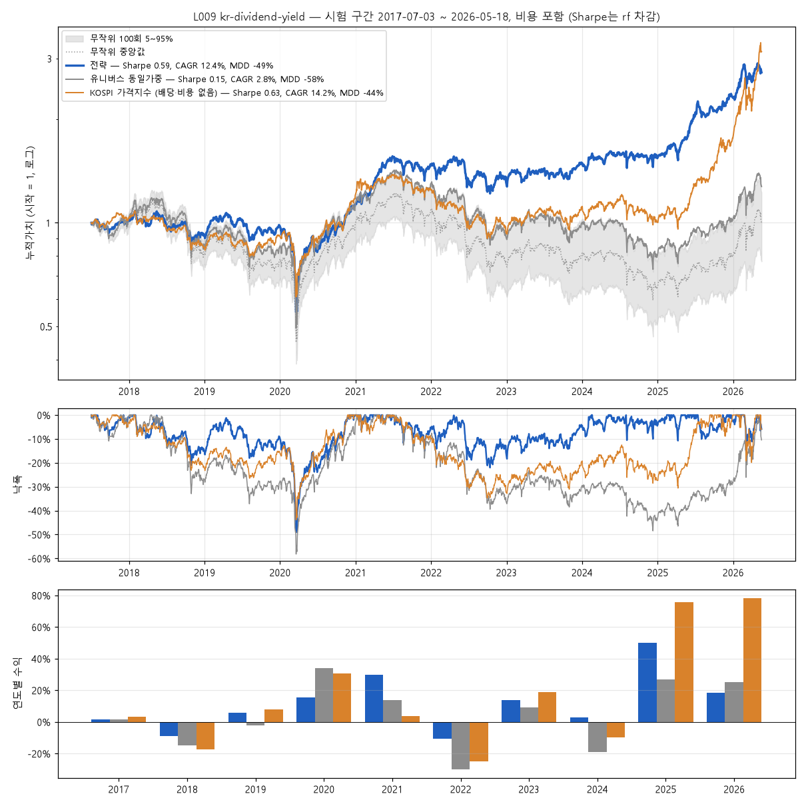

# L009 — KR 배당수익률 상위 20%

고전 퀀트 프로그램 5번째 기법 ([docs/research/2026-11-18-classic-quant-factors.md](../../docs/research/2026-11-18-classic-quant-factors.md) 5절).
**가설·규칙은 2026-11-18, L005~L008 결과(기준 1 통과 0개, 단면 요인은 동일가중보다 우세)를 본 뒤에 커밋했다.** 규칙은 문헌·프로그램 공통값으로 고정하고 그 결과에 맞춰 고르지 않았지만, 같은 KR 개발 구간 노출이 있어 `exposed_from: [L001, L005, L006, L007, L008]`.

## 1. 타겟 시장
- 시장 / 유니버스 / 타임프레임: KR 주식 KOSPI+KOSDAQ (상장폐지 포함) / 일봉, 월 1회 리밸런싱
- 유니버스 (프로그램 공통, 사전 고정): 보통주(코드 끝 0), 원본 종가 ≥ 1,000원, 20일 평균 거래대금 ≥ 10억 원, 가격 이력 ≥ 252거래일, 그날 거래(거래량 > 0)
- 포트폴리오 (공통): 점수 상위 20%(후보 수 × 0.2, 내림) 동일가중, 매월 첫 거래일 종가로 계산 → 다음 거래일 시가 체결, `rebalance: on_signal`. 상장폐지는 엔진이 청산
- 사전에 정한 비교 (`baseline.py`): KOSPI 지수(참고) / 유니버스 동일가중 / 무작위 같은 종목 수 100회

## 2. 전략 — 백테스트 실행 전에 작성하고 커밋
- 작성일: 2026-11-18
- **가설**:
  1. 배당수익률은 가치 지표의 한 형태이고, 한국에서는 배당/가격이 B/M보다 가치 프리미엄 예측력이 강하다는 연구가 있다 (Jang 2024). 배당은 이익의 질·지배구조 신호이기도 하다. 그래서 배당수익률 상위 종목이 동일가중보다 높은 수익을 낸다.
  2. L005(B/M)보다 변동성·MDD가 작을 것 (배당주는 성숙·저변동 기업이 많음).
  3. 사전 예측: 기준 1 미달, 동일가중 대비 우세.
- 출처: Litzenberger & Ramaswamy (1979), Fama & French (1988), Jang (2024)
- 점수: `div_yield` = 그날 알 수 있는 최근 사업보고서 연간 DPS(중간·분기 포함) / 원본 종가. 배당 0·결측은 제외 → 배당 지급 종목 중 상위 20%
- 데이터 시점: 사업보고서 **최초 접수일 다음 날**부터 (`dart_dividend`, 정정 값이 최초 접수일부터 보이는 경미한 미래참조 — validator 확인 대상). 우선주는 이 lab에서 빠진다(보통주만)
- 파라미터 (공통값): quantile 0.2, min_value 10억, liq_days 20, min_price 1,000, min_hist 252
- 워크포워드: 2015-07-01 시작, 학습 24개월 / 시험 6개월 → 시험 2017-07 ~ 2026-05

## 3. 백테스트 (워크포워드)
- 실행: 2026-11-19 11:33, 결과 `results/20261119-113312/` (git 제외). trials 1 (2026-11-18 중단된 실행은 결과 미열람, 같은 설정 재실행 — trials.log), exposed_from [L001, L005, L006, L007, L008]
- 시험 구간: 2017-07-03 ~ 2026-05-18 (2,175봉), 잠금 구간 안 봄
- 비용: 포함 — 수수료 0.015% + 슬리피지 0.05%(한쪽), 매도세 날짜별, 배당 재투자(배당소득세 15.4% 차감), 현금 이자 미반영. 비용 2배 결과도 아래 표
- 생존편향: 없음 (krx_1d 상장폐지 종목 포함, 정리매매 손실 유지, ±35% 초과 하루 변동은 수익 0 처리). 미래참조 자동 검사 통과(데이터를 3곳에서 잘라 신호 재계산; dps·div_yield 재구성 비교 통과). 정정 공시 값이 최초 접수일부터 보이는 경미한 미래참조는 validator 확인 대상

- 아래 표는 **2026-11-19 새 엔진 재계산 값** (`results/20261119-201357/`, 기준 1·2·3 모두 rf 차감). 첫 실행 값과 그 차이는 3-1절. 표 아래 서술 중 거래·민감도·기준 수치는 첫 실행 기준이며, 판정 기준의 최신 값은 3-1절을 본다

| 비용 포함 | Sharpe (rf 차감) | CAGR | MDD |
|---|---|---|---|
| **L009 배당수익률 상위 20%** | **0.59** (rf=0: 0.71) | 12.4% | −49.1% |
| L009 비용 2배 | 0.53 | 11.0% | −50.5% |
| 유니버스 동일가중 | 0.15 | 2.8% | −58.2% |
| 무작위 100회 중앙값 (5~95%: −0.09~0.13) | 0.03 | 0.0% | −61.6% |
| KOSPI 가격지수, 배당 미포함 | 0.63 | 14.2% | −43.9% |

- KOSPI는 **가격지수, 배당 미포함**(비용 없음). 배당(연 2% 안팎)을 넣으면 KOSPI 쪽이 더 높아진다
- 거래 3,056회, 연 회전율 7.0, 연 비용 1.2%, 평균 보유 114 / 유니버스 1,066. 학습 Sharpe 평균 0.64 (rf=0)
- 기준 2: 시험 0.71 vs 학습 0.64 (둘 다 rf=0) → 통과
- 기준 3 민감도 최저 0.64 (rf=0, quantile 0.24) → **rf 차감 환산 0.53** (기본 실행 rf 차이 0.11을 뺀 값) → 통과 (경계 근처)
- 연도별 동일가중 대비 우세 7/10년, 무작위 100회 모두 상회. KOSPI 대비 우세 4/10년 (2021·2024 크게 우세, 2025·2026 상승장에서 크게 뒤짐)
- 관찰: 지금까지 KR 요인 중 동일가중 대비 초과가 가장 크지만(연 CAGR +9.6%p), **배당 미포함 KOSPI 가격지수에도 Sharpe·MDD 모두 못 미친다**. 사전 예측(기준 1 미달, 동일가중 대비 우세) 맞음. "L005보다 MDD 작음"은 −49.6% vs −59%로 맞지만 시험 구간이 다르다. 배당주 전략인데 회전율이 7.0으로 높은 것은 가격이 움직이면 수익률 순위가 바뀌기 때문으로 보임 (validator 확인)
- 기준 1 실패, 2·3(rf 환산)·4·5 통과, 7은 validator 확인

### 3-1. 엔진 변경 후 재계산 (2026-11-19, 같은 설정, trials 2)
- 엔진 `feaa180`(판정 Sharpe를 rf 차감으로 통일, 거래정지 잔량 비중 상한)·`7d243c4`(KR 4분기 손익 FY·Q3 fs_div 다르면 NaN) 병합 뒤 다시 돌림. 실행 전 trials 1→2, log 기록. 규칙·파라미터 변경 없음
- 결과 `results/20261119-201357/` (이전 `results/20261119-113312/`). 비용 포함, 잠금 구간 안 봄, 생존편향·미래참조 점검은 위와 같음

| | 기준 1 Sharpe | 기준 2 시험 vs 학습 | 기준 3 최저 | 기준 4 비용 2배 총수익 | 기준 5 거래 | 거래정지 잔량 줄인 봉 | MDD |
|---|---|---|---|---|---|---|---|
| 이전 (기준 2·3은 rf=0) | 0.592 ✗ | 0.59 vs 0.64 ✓ | 0.642 ✓ | +146% ✓ | 3,056 ✓ | — | −49.6% |
| **이후 (모두 rf 차감)** | 0.594 ✗ | 0.59 vs 0.52 ✓ | 0.531 ✓ | +146% ✓ | 3,056 ✓ | 53 | −49.1% |

- 판정 기준 결과 변화 없음 (1만 실패, 3은 0.531로 통과). 비교 기준: 동일가중 0.15, 무작위 중앙 0.03, KOSPI 0.63

### 3-2. 비교 그림 (3-1 재계산 결과, 시험 구간)

- 전략 vs 유니버스 동일가중 vs 무작위 100회 5~95% 띠 vs KOSPI 가격지수(배당·비용 없음). 위: 누적가치(로그, 시작 = 1)와 범례에 Sharpe(rf 차감)·CAGR·MDD, 가운데: 낙폭, 아래: 연도별 수익
- 다시 그리기: `baseline.py <결과 폴더>` → `plot.py <결과 폴더>` (판정과 무관한 시각화, trials 미포함)

### 3-3. 한계·진단 (진단은 trials 미포함)
- **데이터 오류 067900 (validator 2026-11-20 발견)**: `dart_dividend`의 dps에 주당이 아니라 배당 총액(904,982,950원, 2026-02부터 1,266,976,130원)이 들어가 div_yield가 수만 배로 잡혀, 2023-08부터 최소 2026-02까지 매달 1위로 편입됐다. 동일가중 1/114 비중이라 영향 추정은 **약 −0.3%p** (그 기간 가격 10,480 → 6,500, validator 추정). 규칙·결과는 바꾸지 않았고, `dart_dividend` 이상치 검사는 전략부 HQ가 개발부에 요청한다. 같은 필드를 쓰는 lab에도 해당한다
- **비교 기준 해석 (validator)**: 유니버스 동일가중에는 무배당 적자 소형주가 많아 낮다. 배당 지급 종목만의 동일가중 대비로 보면 CAGR 초과는 +9.6%p가 아니라 +5.0%p다
- **fin_timing last 민감도 — 해당 없음 (진단, 2026-11-20 확인)**: 이 lab은 재무 필드 없이 배당 필드(`dps`, `div_yield`)만 쓴다. 엔진은 배당 필드를 `fin_timing`과 관계없이 항상 사업보고서 **최초 접수일 다음 날**부터 보이게 한다(`backtest/data.py` DIV_TIMING). 그래서 `fin_timing: last`로 바꿔도 결과가 같고, 정정 배당 공시를 정정일부터 반영하는 옵션은 엔진에 없다. 정정 공시 값이 최초 접수일부터 보이는 경미한 미래참조는 그대로 남는 한계다 (배당 정정은 드물다 — 영향 크기는 재지 않음). 필요하면 개발부에 배당 필드 `last` 옵션을 요청할 수 있다.

## 4. 유효성 검증 (labs/README.md의 고정 기준)
- [ ] 1. 시험 구간 Sharpe ≥ 1.0
- [ ] 2. 시험 Sharpe ≥ 학습 Sharpe × 0.5
- [ ] 3. 파라미터 ±20%에서 Sharpe ≥ 0.5
- [ ] 4. 비용 2배에서도 수익
- [ ] 5. 거래 수 ≥ 30
- [ ] 6. 잠금 구간 — 열지 않음 (프로그램 규칙)
- [ ] 7. 생존편향·미래참조 점검

## 판정
- 결과: (사용자 판정 대기)
