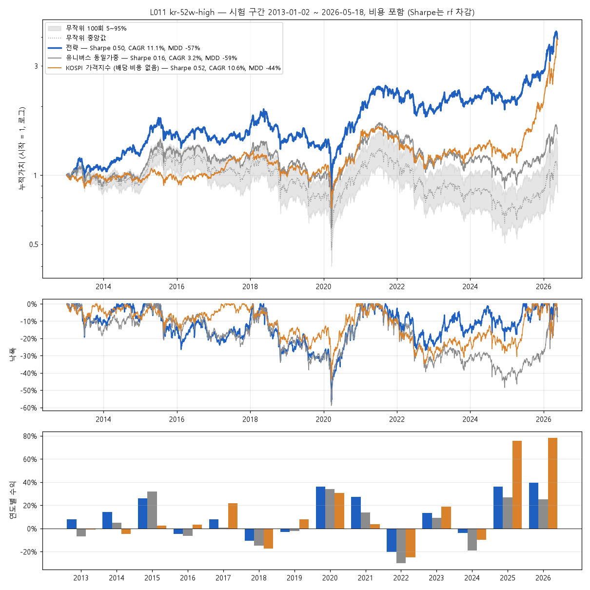

# L011 — KR 52주 신고가 근접도 상위 20%

고전 퀀트 프로그램 7번째 기법 ([docs/research/2026-11-18-classic-quant-factors.md](../../docs/research/2026-11-18-classic-quant-factors.md) 5절).
**가설·규칙은 2026-11-18, L005~L008 결과(기준 1 통과 0개, 단면 요인은 동일가중보다 우세)를 본 뒤에 커밋했다.** 규칙은 문헌·프로그램 공통값으로 고정하고 그 결과에 맞춰 고르지 않았지만, 같은 KR 개발 구간 노출이 있어 `exposed_from: [L001, L005, L006, L007, L008]`.

## 1. 타겟 시장
- 시장 / 유니버스 / 타임프레임: KR 주식 KOSPI+KOSDAQ (상장폐지 포함) / 일봉, 월 1회 리밸런싱
- 유니버스 (프로그램 공통, 사전 고정): 보통주(코드 끝 0), 원본 종가 ≥ 1,000원, 20일 평균 거래대금 ≥ 10억 원, 가격 이력 ≥ 252거래일, 그날 거래(거래량 > 0)
- 포트폴리오 (공통): 점수 상위 20%(후보 수 × 0.2, 내림) 동일가중, 매월 첫 거래일 종가로 계산 → 다음 거래일 시가 체결, `rebalance: on_signal`. 상장폐지는 엔진이 청산
- 사전에 정한 비교 (`baseline.py`): KOSPI 지수(참고) / 유니버스 동일가중 / 무작위 같은 종목 수 100회

## 2. 전략 — 백테스트 실행 전에 작성하고 커밋
- 작성일: 2026-11-18
- **가설**:
  1. 투자자는 52주 최고가를 기준점(앵커)으로 삼아, 신고가 근처 종목의 좋은 소식에 늦게 반응한다. 그래서 신고가에 가까운 종목이 이후 더 오른다 (George & Hwang 2004). 12-1 모멘텀보다 반전·붕괴가 작다고 알려져 있다.
  2. 한국은 모멘텀이 약하고(Chui·Titman·Wei 2010, L001 기각) 신고가 근처 종목에 테마주가 섞여 효과가 약할 수 있다. **기각 가능성이 높다**고 보고 시작한다. 다만 신고가 근접도는 고변동 급등주보다 꾸준히 오른 종목을 고르는 경향이 있어 L001과 다를 수 있다.
  3. 사전 예측: 기준 1 미달, 동일가중 대비 우세 여부는 불확실.
- 출처: George & Hwang (2004, *JF*) "The 52-week high and momentum investing"
- 점수: 오늘 종가 / 최근 252거래일(오늘 포함) 최고 종가 (수정주가, 배당 재투자). 유효 종가가 202개(80%) 미만이면 제외
- 원 논문과의 차이: GH는 6개월 보유·롱숏이지만 여기서는 프로그램 공통 규칙(월 1회, 5분위 롱 온리)을 쓴다. 장중 고가 대신 종가 최고가
- 파라미터: high_days 252, 나머지 공통값
- 워크포워드: 2011-01-01 시작 (L001·L007과 같음) → 시험 2013-01 ~ 2026-05

## 3. 백테스트 (워크포워드)
- 실행: 2026-11-19 12:48, 결과 `results/20261119-124839/` (git 제외). trials 1 (2026-11-18 중단된 실행은 결과 미열람, 같은 설정 재실행 — trials.log), exposed_from [L001, L005, L006, L007, L008]
- 시험 구간: 2013-01-02 ~ 2026-05-18 (3,283봉), 잠금 구간 안 봄
- 비용: 포함 — 수수료 0.015% + 슬리피지 0.05%(한쪽), 매도세 날짜별, 배당 재투자(배당소득세 15.4% 차감), 현금 이자 미반영. 비용 2배 결과도 아래 표
- 생존편향: 없음 (krx_1d 상장폐지 종목 포함, 정리매매 손실 유지, ±35% 초과 하루 변동은 수익 0 처리). 미래참조 자동 검사 통과(데이터를 3곳에서 잘라 신호 재계산). 정정 공시 값이 최초 접수일부터 보이는 경미한 미래참조는 validator 확인 대상

- 아래 표는 **2026-11-19 새 엔진 재계산 값** (`results/20261119-214341/`, 기준 1·2·3 모두 rf 차감). 첫 실행 값과 그 차이는 3-1절. 표 아래 서술 중 거래·민감도·기준 수치는 첫 실행 기준이며, 판정 기준의 최신 값은 3-1절을 본다

| 비용 포함 | Sharpe (rf 차감) | CAGR | MDD |
|---|---|---|---|
| **L011 52주 신고가 근접 상위 20%** | **0.50** (rf=0: 0.60) | 11.1% | −56.8% |
| L011 비용 2배 | 0.39 | 8.4% | −58.5% |
| 유니버스 동일가중 | 0.16 | 3.2% | −58.9% |
| 무작위 100회 중앙값 (5~95%: −0.05~0.11) | 0.03 | 0.4% | −64.5% |
| KOSPI 가격지수, 배당 미포함 | 0.52 | 10.6% | −43.9% |

- KOSPI는 **가격지수, 배당 미포함**(비용 없음). 배당(연 2% 안팎)을 넣으면 KOSPI 쪽이 더 높아진다
- 거래 15,894회, 연 회전율 12.8, **연 비용 2.5%** (비용 없음 Sharpe 0.72), 평균 보유 192 / 유니버스 961. 학습 Sharpe 평균 0.48 (rf=0)
- 기준 2: 시험 0.61 vs 학습 0.48 (둘 다 rf=0) → 통과
- 기준 3 민감도 최저 0.53 (rf=0, high_days 202) → **rf 차감 환산 0.43** (rf 차이 0.10을 뺀 값) → 실패
- 연도별 동일가중 대비 우세 12/14년, 무작위 100회 모두 상회. KOSPI와는 Sharpe 비슷하지만 MDD가 13%p 더 나쁨
- 관찰: 사전 예측 "기각 가능성 높음, 동일가중 대비 우세 불확실" 중 기각은 맞고, 동일가중 대비로는 예상보다 꾸준했다(L001 12-1 모멘텀과 다름). 다만 배당 미포함 KOSPI를 넘지 못하고 회전율 비용이 크다
- 기준 1·3(rf 환산) 실패, 2·4·5 통과, 7은 validator 확인

### 3-1. 엔진 변경 후 재계산 (2026-11-19, 같은 설정, trials 2)
- 엔진 `feaa180`(판정 Sharpe를 rf 차감으로 통일, 거래정지 잔량 비중 상한)·`7d243c4`(KR 4분기 손익 FY·Q3 fs_div 다르면 NaN) 병합 뒤 다시 돌림. 실행 전 trials 1→2, log 기록. 규칙·파라미터 변경 없음
- 결과 `results/20261119-214341/` (이전 `results/20261119-124839/`). 비용 포함, 잠금 구간 안 봄, 생존편향·미래참조 점검은 위와 같음

| | 기준 1 Sharpe | 기준 2 시험 vs 학습 | 기준 3 최저 | 기준 4 비용 2배 총수익 | 기준 5 거래 | 거래정지 잔량 줄인 봉 | MDD |
|---|---|---|---|---|---|---|---|
| 이전 (기준 2·3은 rf=0) | 0.505 ✗ | 0.50 vs 0.48 ✓ | 0.532 ✓ | +187% ✓ | 15,894 ✓ | — | −56.9% |
| **이후 (모두 rf 차감)** | 0.504 ✗ | 0.50 vs 0.36 ✓ | 0.431 ✗ | +185% ✓ | 15,894 ✓ | 94 | −56.8% |

- **기준 3 통과 → 실패** (0.431). 비교 기준: 동일가중 0.16, 무작위 중앙 0.03, KOSPI 0.52

### 3-2. 비교 그림 (3-1 재계산 결과, 시험 구간)

- 전략 vs 유니버스 동일가중 vs 무작위 100회 5~95% 띠 vs KOSPI 가격지수(배당·비용 없음). 위: 누적가치(로그, 시작 = 1)와 범례에 Sharpe(rf 차감)·CAGR·MDD, 가운데: 낙폭, 아래: 연도별 수익
- 다시 그리기: `baseline.py <결과 폴더>` → `plot.py <결과 폴더>` (판정과 무관한 시각화, trials 미포함)

## 4. 유효성 검증 (labs/README.md의 고정 기준)
- [ ] 1. 시험 구간 Sharpe ≥ 1.0
- [ ] 2. 시험 Sharpe ≥ 학습 Sharpe × 0.5
- [ ] 3. 파라미터 ±20%에서 Sharpe ≥ 0.5
- [ ] 4. 비용 2배에서도 수익
- [ ] 5. 거래 수 ≥ 30
- [ ] 6. 잠금 구간 — 열지 않음 (프로그램 규칙)
- [ ] 7. 생존편향·미래참조 점검

## 판정
- 결과: **rejected** (사용자 판정 2026-11-20, validator 의견 rejected)
- 이유: 기준 1·3 실패 (0.50, 0.43). KOSPI 대비 알파 없음(t 0.67), 연 비용 2.5%
- 의견서: [validation.md](validation.md). 잠금 구간은 열지 않았다 (프로그램 규칙)
