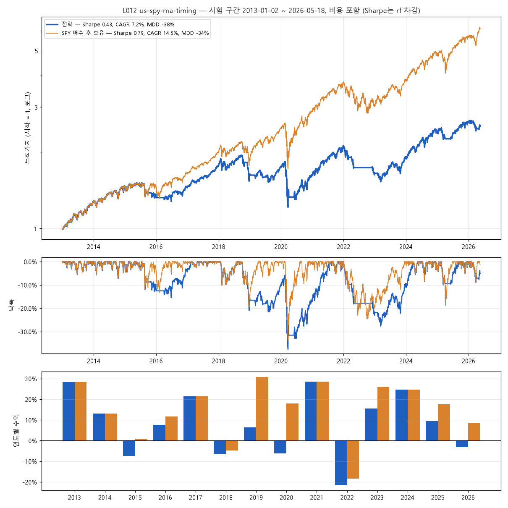

# L012 — US 국면 필터 단독: SPY 200일선 타이밍

고전 퀀트 프로그램 8번째 기법 ([docs/research/2026-11-18-classic-quant-factors.md](../../docs/research/2026-11-18-classic-quant-factors.md) 5절).
**가설·규칙은 2026-11-18, L008(KR 같은 규칙) 결과를 본 뒤에 커밋했다.** 시장·데이터 구간은 다르지만 같은 규칙의 결과를 봤으므로 `exposed_from: [L008]`. 규칙은 L008과 같은 200일·월 1회로 고정하고 바꾸지 않는다 (**정정 2026-11-20: 판단일은 L008과 1봉 다르다 — 3-3절**).

## 1. 타겟 시장
- 시장 / 유니버스 / 타임프레임: US, SPY 한 종목 / 일봉, 월 1회 판단
- 이 시장을 고른 이유: US 종목 선택 전략은 생존편향 때문에 판정할 수 없지만, SPY(S&P500 ETF) 하나만 쓰는 지수 타이밍은 편향이 없다. KR L008과 같은 규칙을 다른 시장에서 확인하는 의미도 있다.

## 2. 전략 — 백테스트 실행 전에 작성하고 커밋
- 작성일: 2026-11-18
- **가설**:
  1. 주가지수는 추세가 이어지고 큰 하락장은 대개 장기 이동평균 아래에서 일어난다. 그래서 SPY가 200일선 아래일 때 현금이면 MDD가 크게 준다 (Faber 2007).
  2. 2013~2026 미국은 강한 상승장이라 속임 신호(2015~16, 2018 말, 2020-03 V자, 2022 이후 반등)로 **수익과 Sharpe는 보유보다 낮을 것**.
  3. 사전 예측: Sharpe는 보유(약 0.8 안팎)보다 낮거나 비슷, MDD는 보유(−34% 안팎)보다 작음, **기준 1 미달**.
- 출처: Faber (2007), Brock, Lakonishok & LeBaron (1992), Moskowitz, Ooi & Pedersen (2012)
- 진입 규칙: 매월 첫 거래일 SPY 종가 > SPY 200거래일 종가 이동평균이면 다음 거래일 시가에 SPY 100%, 아니면 전액 현금
- 청산 규칙: 다음 월초 판단에서 조건이 꺼지면 전량 매도. 월중 판단 없음.
- 실행 유형: portfolio, `rebalance: on_signal`
- 파라미터: ma_days 200 (L008과 같음 — 단 판단일은 1봉 다름, 3-3절 정정)
- 가격: us_1d 분할 반영 종가 + 배당 재투자(원천징수 15%), USD 기준(환율 미반영). 비용은 `config/settings.yaml` US 기본값.
- 거래 수 주의: 종목이 하나라 신규 진입 횟수 = 국면 전환 중 진입 횟수다. 30회에 못 미칠 수 있으며, 그러면 기준 5 탈락으로 기록한다 (규칙을 바꾸지 않는다).
- 현금 이자 미반영 (엔진 한계, 전략에 불리).
- 사전에 정한 비교: SPY 매수 후 보유 (lab.yaml `benchmark: SPY`, 같은 비용)
- 워크포워드: 2011-01-01 시작, 학습 24개월 / 시험 6개월 → 시험 2013-01 ~ 2026-05

## 3. 백테스트 (워크포워드)
- 실행: 2026-11-18 21:19, 결과 `results/20261118-211925/` (git 제외). trials 1, exposed_from [L008]. 2026-11-18 중단 지시 전에 끝난 실행 (HQ 확인)
- 시험 구간: 2013-01-02 ~ 2026-05-15 (3,363봉), 잠금 구간 안 봄
- 비용: 포함 — 수수료 0.25% + 슬리피지 0.05%(한쪽, `config/settings.yaml` US 기본값), 배당 재투자(원천징수 15%), USD 기준(환율·환전 비용 미반영), 현금 이자 미반영
- 생존편향: 이 lab에는 없음 (SPY 한 종목. 엔진 보고서의 "생존편향: 있음"은 us_1d 전체에 대한 일반 경고). 미래참조 자동 검사 통과

- 아래 표는 **2026-11-19 새 엔진 재계산 값** (`results/20261119-220427/`, 기준 1·2·3 모두 rf 차감). 첫 실행 값과 그 차이는 3-1절. 표 아래 서술 중 거래·민감도·기준 수치는 첫 실행 기준이며, 판정 기준의 최신 값은 3-1절을 본다

| 비용 포함 | Sharpe (rf 차감) | Sharpe (rf=0) | 총수익 | MDD |
|---|---|---|---|---|
| **L012 SPY 200일선** | **0.43** | 0.56 | +152% (CAGR 7.2%) | −37.6% |
| L012 비용 2배 | 0.40 | 0.52 | +135% | −38.7% |
| SPY 매수 후 보유 (같은 비용) | 0.79 | 0.89 | +512% | −33.8% |

- 거래 12회(진입), 연 회전율 1.7, 학습 Sharpe 평균 0.67 (rf=0)
- 민감도: ma 160일 0.55, 240일 0.63 (rf=0) → **rf 차감 근사 0.42~0.50** (기본 실행의 rf 차이 0.12를 뺀 값)
- 관찰: 사전 예측(Sharpe 보유 이하, 기준 1 미달)은 맞았지만 **MDD도 보유보다 나쁘다**(−37.6% vs −33.8%) — 예측과 다름. 월 1회 판단이라 2020-03 같은 급락을 피하지 못하고, 반등을 놓친 뒤 다시 들어가는 비용이 컸던 것으로 보임 (validator 확인 대상). 기준 1·5 실패, 기준 3은 rf 차감 기준으로 실패.

### 3-1. 엔진 변경 후 재계산 (2026-11-19, 같은 설정, trials 2)
- 엔진 `feaa180`(판정 Sharpe를 rf 차감으로 통일, 거래정지 잔량 비중 상한)·`7d243c4`(KR 4분기 손익 FY·Q3 fs_div 다르면 NaN) 병합 뒤 다시 돌림. 실행 전 trials 1→2, log 기록. 규칙·파라미터 변경 없음
- 결과 `results/20261119-220427/` (이전 `results/20261118-211925/`). 비용 포함, 잠금 구간 안 봄, 생존편향·미래참조 점검은 위와 같음

| | 기준 1 Sharpe | 기준 2 시험 vs 학습 | 기준 3 최저 | 기준 4 비용 2배 총수익 | 기준 5 거래 | 거래정지 잔량 줄인 봉 | MDD |
|---|---|---|---|---|---|---|---|
| 이전 (기준 2·3은 rf=0) | 0.435 ✗ | 0.43 vs 0.67 ✓ | 0.546 ✓ | +136% ✓ | 12 ✗ | — | −37.6% |
| **이후 (모두 rf 차감)** | 0.434 ✗ | 0.43 vs 0.56 ✓ | 0.422 ✗ | +135% ✓ | 12 ✗ | 0 | −37.6% |

- **기준 3 통과 → 실패** (0.422). SPY 매수 후 보유(같은 비용) rf 차감 Sharpe 0.79 (rf=0 0.89), MDD −33.8%

### 3-2. 비교 그림 (3-1 재계산 결과, 시험 구간)

- 전략 vs SPY 매수 후 보유 (같은 비용). 위: 누적가치(로그, 시작 = 1)와 범례에 Sharpe(rf 차감)·CAGR·MDD, 가운데: 낙폭, 아래: 연도별 수익
- 다시 그리기: `baseline.py <결과 폴더>` → `plot.py <결과 폴더>` (판정과 무관한 시각화, trials 미포함)

### 3-3. 한계·정정 (2026-11-20, validator 반영, 새 실행 없음)
- **정정 — "L008과 똑같은 규칙"은 사실과 다르다.** L008은 KOSPI를 `shift(1)` 해서 **전월 마지막 거래일 종가**로 판단하고, L012는 **당월 첫 거래일 종가**로 판단한다(둘 다 다음 봉 시가 체결). 위 1·2절의 "L008과 같은 규칙", "(L008과 같음)"은 이동평균 길이(200일)와 월 1회 판단이 같다는 뜻이고, 판단일은 1봉 다르다.
- **이 1봉 차이로 결과가 크게 갈린다** (validator 재구성, 비용 포함 rf 차감): 사전등록 규칙(당월 첫 거래일) 0.43 vs 1봉 지연(전월 마지막 거래일, L008과 같은 판단일) 0.58 (MDD −27.7%), 2봉 지연 0.70. 결과가 판단일 하루에 좌우된다는 것 자체가 신호가 약하다는 뜻이다(국면 전환 23회 중 절반 이상이 1~3개월 안에 되돌린 휩소).
- **판단일을 바꾼 재시험은 새 시도다.** 1봉 지연 결과를 보고 판단일을 바꾸면 trials +1이고, 위 결과를 이미 봤으므로 사후 선택이다.
- **이미 노출된 변형** (validator가 돌림 — 앞으로 SPY 추세 규칙을 다시 시험하면 이 계열의 시도로 센다): 이동평균 150~250일 격자(150·160·180·220·240·250일), 신호 0~2봉 지연, 원본 종가(배당 미반영) 신호.
- 그 밖: 거래 12회(국면 전환 23회)로 기준 5 실패, 표본이 너무 적어 효과를 판별할 수 없다. 현금 이자 미반영(Sharpe는 rf 차감이라 판정 영향 작음).

## 4. 유효성 검증 (labs/README.md의 고정 기준)
- [ ] 1. 시험 구간 Sharpe ≥ 1.0
- [ ] 2. 시험 Sharpe ≥ 학습 Sharpe × 0.5
- [ ] 3. 파라미터 ±20%에서 Sharpe ≥ 0.5
- [ ] 4. 비용 2배에서도 수익
- [ ] 5. 거래 수 ≥ 30
- [ ] 6. 잠금 구간 — 열지 않음 (프로그램 규칙)
- [ ] 7. 생존편향·미래참조 점검

## 판정
- 결과: (사용자 판정 대기)
