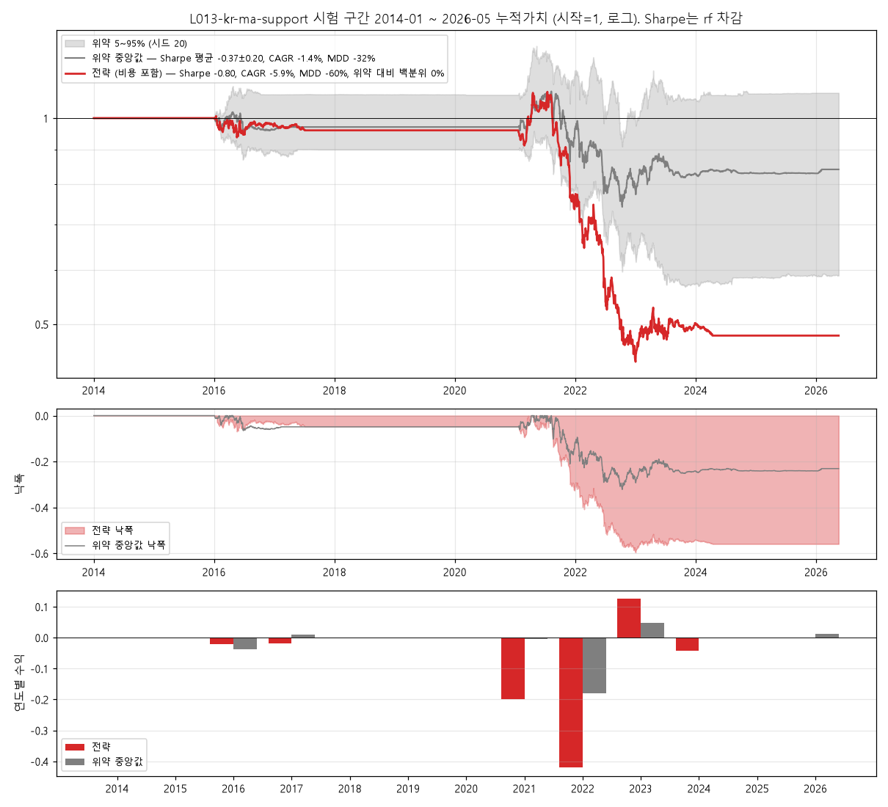

# L013 — KR 이동평균 지지 반등 (손익비 3:1 이상만)

> 사용자 아이디어 "지지와 저항 전략"(2026-11-19)의 하위 전략 1/3. 같은 아이디어의 나머지: [L014 박스권](../L014-kr-box-range/README.md), [L015 거래량 동반 돌파](../L015-kr-volume-breakout/README.md).
> 세 lab은 같은 날 같이 사전등록했고, 공통 설정(사이징·워크포워드 창·비교 기준)이 같다.

## 0. 사용자 원문 요지 (2026-11-19)
- 이동평균선을 지지·저항선으로 보고, **손익비 3:1 이상**인 자리만 진입. 이평은 KR 5·10·20·60·120·240일, US 5·10·20·50·100·125·200일.
- 긴 이평일수록 지지·저항이 강하고, **가중값은 학습으로** 정한다. 매수가에서 손절가·익절가를 명확히 정해 진입.
- 하위 전략: ① 박스권(→ L014) ② 거래량 동반 돌파(→ L015).

### 이미 본 것과 겹침 (L003, rejected 2026-11-18)
- L003은 같은 개발 구간에서 200일선 상향 돌파, 50/200 골든크로스, 피보나치 되돌림 반등 등을 20봉 수익으로 위약 대비 검정 → 통과 0.
  KR 200일선 돌파(12,028건)는 반대 방향(−0.39%). 그래서 `trials.exposed_from: [L003]`.
- **이 lab에서 새로 보는 것**: 이평 "돌파"가 아니라 **위에서 내려와 이평에 닿고 반등하는 지지 매수**, 여러 이평(5~240)의 겹침 점수,
  학습한 이평별 가중값, 손절·익절가를 정한 3:1 손익비 필터와 손절·목표가 청산.

## 1. 타겟 시장
- 시장 / 유니버스 / 타임프레임: KR 주식 `krx_1d` 전체(상장폐지 포함) 중 그날 20일 평균 거래대금 ≥ 10억 원, 원본 종가 ≥ 1,000원, 245봉 이상 이력 / 일봉.
- 이유: 생존편향이 없는 데이터라 판정 근거가 된다. US(`us_1d`는 현재 구성종목만)는 [us/](us/)에서 참고로만 돌린다 (아래 5절).

## 2. 전략 — 백테스트 실행 전에 작성하고 커밋
- 작성일: 2026-11-19
- **가설**: 많은 참여자가 같은 이평(특히 20·60·120일)을 보고 눌림목 매수를 한다면, 상승 중인 이평까지 내려왔다가 양봉으로 되돌린 자리는
  주문이 몰리는 지지가 되어 손절 거리(지지선 바로 아래)가 짧다. 위쪽 첫 저항까지의 거리가 손절 거리의 3배 이상인 자리만 고르면,
  승률이 25%를 조금만 넘어도 비용 뒤 기대값이 양수다. 긴 이평일수록, 여러 이평이 겹칠수록 지지가 강하다(사용자 가정 — 학습으로 확인).
- 반대 가설(이것이 맞으면 기각): 이평 터치·반등은 공개된 정보라 이미 가격에 반영돼 있고, 3:1 필터는 "위 저항까지 멀다 = 최근 크게 빠졌다"를
  고르는 효과일 뿐이며, 승률은 손절·목표 거리로 정해지는 무작위 수준(약 1/(1+RR))에 머문다.
- 출처: 실전 트레이더의 이평 지지·저항 매매(사용자 지인), Brock·Lakonishok·LeBaron(1992) 이평 규칙, 손익비 기반 진입(R 배수, Van Tharp).
- 진입 규칙 (봉 t 종가까지 보고, t+1 시가 진입):
  1. 이평 k ∈ {5, 10, 20, 60, 120, 240}마다 **지지 터치**: 이평 상승 중(MA_k > 5봉 전 MA_k), 저가 ≤ MA_k × 1.01, 종가 > MA_k,
     전일 종가 > 전일 MA_k (위에서 내려와 닿음), 양봉(종가 > 시가).
  2. 점수 = 터치한 이평들의 가중값 합. 가중값 0인 이평은 신호를 만들지 않는다.
  3. 손절 = min(당일 저가, 터치한 이평 중 가장 낮은 값) × 0.99.
  4. 목표 = 종가 위 가장 가까운 저항 × 0.995. 저항 후보 = 종가 위의 모든 이평, 직전 60봉 고점, 직전 250봉 고점. 저항이 없으면 진입 안 함.
  5. 손익비 (목표 − 종가) / (종가 − 손절) ≥ 3.0. 같은 날 점수 → 20일 평균 거래대금 순 상위 5개만 신호.
- **가중값 학습 (`fit`)**: 워크포워드 학습 창(36개월) 데이터만으로, 이평마다 "그 이평 하나만 지지로 쓴 신호"를 t+1 시가에 진입시켜
  손절·목표가(같은 봉이면 손절)·최대 60봉 보유로 결과를 시뮬레이션하고, 왕복 비용 0.5%를 뺀 평균 R(손절 거리 단위 수익)을 잰다.
  가중값 = max(0, 평균 R × n/(n+200)). 즉 학습 창에서 비용 뒤 기대값이 음수인 이평은 꺼진다. 전부 음수면 그 시험 창은 거래하지 않는다.
  (fit 전 기본값은 긴 이평일수록 큰 사전값 5:0.5 … 240:1.5 — 미래참조 검사용이며 시험 구간 신호는 항상 fit 값으로 만든다.)
- 청산 규칙: 엔진이 손절가·목표가로만 청산 (같은 봉에서 둘 다 닿으면 손절, 시가 갭은 시가). **시간 청산 없음** — 엔진(`backtest/trade.py`)에
  보유 기간 상한이 없다. 목표·손절 둘 다 안 닿으면 계속 보유한다(보고서의 평균 보유 봉·기말 미청산 건수로 확인).
- 실행 유형: `type: trade`
- 포지션 크기 (`lab.yaml` `trade`, 세 lab 공통): 거래당 위험 1%, 열린 위험 합 10%, 종목당 10%, 동시 보유 10종목, Kelly 안 씀. 자본 1,000만 원(기본).
- 파라미터: `lab.yaml` `params` (touch 1%, 손절 버퍼 1%, 목표 버퍼 0.5%, 저항 창 60, RR 3.0, 하루 5개, 거래대금 10억, 주가 1,000원, 학습 60봉·비용 0.5%·축소 200).

### 비교 기준 (사전등록)
1. **무작위 종목 위약** (`placebo.py`, 시드 20개): 같은 시험 구간 신호마다 같은 날 유니버스 조건을 만족하는 다른 종목을 무작위로 골라
   손절·목표를 같은 **비율 거리**로 옮겨 같은 엔진으로 재생. 전략 Sharpe가 위약 Sharpe 분포의 어디에 있는지(백분위) 본다.
   → "이평 지지라는 자리"가 같은 손절·목표 구조의 아무 자리보다 나은지를 가른다. 이 실행은 lab 엔진 실행과 같은 시도로 센다.
2. 고정 기준 7개 (`labs/README.md`) — 판정은 이것으로만. 위약은 해석 보조.

### 예측 먼저 (결과를 보기 전에 기록, 2026-11-19)
- **lead agent (Claude)**: 고정 기준 1(시험 Sharpe ≥ 1.0) **불통과** (확신 80%). 시험 Sharpe −0.2 ~ +0.4, 승률 20~28%(손익비 3이면 손익분기 약 25% + 비용),
  위약 대비 백분위 40~70%(위약과 구별 안 됨). 학습 가중값은 긴 이평이 크지 않고 창마다 들쭉날쭉할 것 — 근거: L003에서 KR 이평 신호가 반대 방향이거나 0이었고,
  KR은 단기 반전 성향이 있어 "눌림 반등"이 돌파보다는 낫겠지만 비용(매도세 포함 왕복 약 0.4~0.5%)을 넘기 어렵다.
- **사용자**: (결과 전에 받지 못함 — 사용자가 결과를 먼저 봄. 예측 기록 없음)

## 3. 백테스트 (워크포워드)
- 시도 횟수: `lab.yaml` `trials` — 실행 전에 +1, 로그, 커밋. 현재 2회(아래 노출 1 + 실행 1). `exposed_from: [L003, L008, L012]` (L008·L012는 전략부 HQ 지정).
- **사전등록 전 노출 1건 (투명 공개)**: 코드 점검(신호 개수·속도·잘라내기 검사) 중 `fit` 출력을 한 번 화면에 찍었다 —
  2011-01 ~ 2014-01 학습 창(첫 창과 같은 기간)의 이평별 비용 뒤 평균 R이 6개 모두 음수(−0.32 ~ −0.97), 가중값 전부 0.
  첫 시험 창(2014-01~06)은 거래하지 않게 된다는 뜻이다. 이것을 본 뒤 **규칙·파라미터를 바꾸지 않았다** (위 2절은 그 전에 쓴 그대로).
  시도 1회로 센다.
- 실행 계획 (사전등록): 시도 1회 = `uv run python -m autotrader.backtest.lab labs/L013-kr-ma-support`(±20% 민감도 포함, `--quick` 아님) + `placebo.py`(시드 20).
  결과를 보고 규칙을 바꾸면 그것은 새 시도이고, 이 작업 범위에서는 하지 않는다 (사용자·전략부 HQ 결정).
- 개발 구간: 2011-01-01 ~ 2026-05-18(잠금 구간 직전, 실행일 기준). 학습 36개월 → 시험 6개월 앞으로 굴림, 첫 시험 창 2014-01.
- 비용: 엔진 기본값 — 수수료 0.015%(양쪽), 슬리피지 0.05%(양쪽), 매도세 연도별 표(2025년 0.15%, 2026년 0.20% 등). 비용 2배 자동 계산.
- 결과 요약 (실행 2026-11-20, 결과 `results/20261120-025048/`, 위약 `results/placebo-20261120-030211.json`):

  | 항목 | 값 | 기준·비고 |
  |---|---|---|
  | 시험 구간 | 2014-01-02 ~ 2026-05-18 (워크포워드 시험 창 25개 이어 붙임) | 잠금 구간 안 열었음 |
  | 시험 Sharpe (비용 포함, rf 차감) | **−0.80** (rf 안 뺀 값 −0.58) | 기준 ≥ 1.0, 높을수록 좋음 |
  | 학습 Sharpe 평균 | −79.60 (의미 없는 값 — 아래 "학습 가중값" 참고) | rf 안 뺀 값 −0.13 |
  | 비용 없을 때 / 비용 2배 | Sharpe −0.61 (총수익 −39%) / −0.98 (총수익 −62%) | 비용 전에도 손실 |
  | 총수익 / 연복리 / 최대 낙폭 | −52% / −5.9% / −60% | 자본 1,000만 원 → 481만 원 |
  | 거래 수 / 승률 / 평균 R / 손익비 | 634 / 17.4% / +0.07R / 3.51 | 손익비 3.51이면 손익분기 승률 약 22%. 평균 R이 양수인데 손실인 이유는 아래 |
  | 청산 종류 | 손절 523 / 목표 110 / 상장폐지 1 | |
  | 평균 보유 / 기말 미청산 | 9.1봉 / 0건 | 시간 청산 없음 |
  | 진입 못 한 신호 | 보유 10종목 한도 1,323 / 이미 보유 161 | 신호 2,124개 중 634개 체결 |
  | 민감도 ±20% (파라미터 11개 × 2) | Sharpe −1.18 ~ −0.52 | 모두 음수 |
  | 위약 (무작위 종목, 시드 20) | 위약 평균 −0.37 (표준편차 0.20), 전략 백분위 **0%** | 시드 20개 모두보다 나쁨 |
  | 국면별 Sharpe | 상승 −0.56 / 하락 −1.26 / 혼조 −0.52 | 모든 국면 음수 |
  | 시험 창 25개 | 새 진입이 있었던 창 6개, 손익이 있었던 창 11개(나머지 5개는 이전 창에서 넘어온 포지션), 그중 수익 4개 (+3.2%, +9.5%, +8.6%, +3.6%) | 14개 창은 손익 0 |

- **학습 가중값 추이 (가장 중요한 관찰)**: 시험 창 25개 중 19개에서 학습한 가중값이 6개 이평 **모두 0** — 학습 창에서 어느 이평도 비용 뒤 기대값이 양수가 아니었다.
  새 진입이 나온 창은 2016-01(240일만 0.03), 2021-01(240일만 0.07), 2021-07 ~ 2022-07(여러 이평, 60일이 가장 크고(0.15~0.23) 10일선도 큼, 240일은 0.02~0.21로 들쭉날쭉), 2023-01(60일만 0.03)뿐.
  진입 634건이 2016년 상반기 52건, 2021~2023년 상반기 581건(나머지 1건은 6월 말 신호의 2023-07 진입)에 몰려 있다. 시간 청산이 없어 최장 보유는 582일. 2021-07 ~ 2022-12 세 창(2018~2022 학습 창, 2020~2021 상승장 포함)이 −27%, −25%, −23%로 손실 대부분을 냈다
  — 학습 창의 "이평 지지가 통한다"가 다음 6개월 하락장에서 뒤집혔다.
  학습 Sharpe 평균 −79.60은 학습 창에서 거래가 0이라 일별 수익이 "0 − 무위험 수익률"뿐인 창(표준편차가 거의 0)에서 Sharpe가 −100 안팎으로 터진 값이다. 전략 성과를 뜻하지 않는다 (엔진 집계 문제로 개발·점검 HQ에 알림).
- **평균 R +0.07인데 손실인 이유** (validator 지적으로 고침): 거래 1건 때문이다. 053280(2021-07 진입)은 진입 시가가 손절가 바로 위로 갭 하락해
  손절 거리가 0.25%뿐이었고, 목표가에 닿아 R +132가 됐다. 이 1건을 빼면 평균 R −0.14, 금액 가중 R(총손익 ÷ 위험 금액 합) −0.24.
  또 634건 중 602건은 종목당 비중 10% 한도로 수량이 정해져, 손절 거리가 먼 거래일수록 금액 손실이 크다. 금액 손익(−519만 원)이 실제 성과이고, R 평균은 참고만.
- 예측 대비: 불통과(확신 80%)는 맞았다. Sharpe(예측 −0.2 ~ +0.4)·승률(예측 20~28%)·위약 백분위(예측 40~70%)는 모두 예측보다 나빴다.
  "가중값은 긴 이평이 크지 않고 들쭉날쭉"은 절반만 맞음 — 들쭉날쭉한 정도가 아니라 대부분 창에서 전부 0이었다.
- 상·하한가 사후 집계 (원본 일봉 `krx_1d`와 대조, 634건 전부): 상한가 시가 진입 0건, 신호봉이 상한가인 건 1건(0.2%), 하한가 터치 날 손절 0건,
  하한가에 잠긴 날 손절 0건, 같은 봉에서 손절·목표 둘 다 닿아 손절 처리 0건. 진입 당일 손절 119건(18.8%, 평균 −1.24R, −314만 원). → 가격제한·체결 모형 영향은 없다.

### 3-2. 비교 그림 (시각화 — 시도로 세지 않음)

- 대조군: 사전등록한 무작위 종목 위약(시드 20) — 같은 날·같은 손절/목표 비율 거리로 그날 유니버스의 다른 종목에 진입. 회색 띠는 시드 20개 누적가치의 5~95%, 회색 선은 중앙값.
  위: 누적가치(로그, 시작=1, 범례에 Sharpe(rf 차감)·CAGR·MDD) / 가운데: 낙폭 / 아래: 연도별 수익.
- 새 백테스트 없음: 전략 곡선은 lab 실행이 남긴 `test_returns.parquet`, 위약 곡선은 `placebo.py`를 원래 실행 날짜·같은 시드로 재생(시드별 Sharpe가 json과 다르면 멈춤).
- 다시 그리기: `uv run python labs/L013-kr-ma-support/plot.py labs/L013-kr-ma-support` (US 참고: 끝을 `labs/L013-kr-ma-support/us`로 → [us/chart.png](us/chart.png)).

## 4. 유효성 검증 (labs/README.md의 고정 기준)
- [ ] 1. 시험 구간 Sharpe ≥ 1.0 — **불통과** (−0.80)
- [ ] 2. 시험 Sharpe ≥ 학습 Sharpe × 0.5 — **불통과** (학습 Sharpe ≤ 0)
- [ ] 3. 파라미터 ±20%에서 Sharpe ≥ 0.5 — **불통과** (최저 −1.18)
- [ ] 4. 비용 2배에서도 수익 — **불통과** (총수익 −62%)
- [x] 5. 거래 수 ≥ 30 — 통과 (634)
- [ ] 6. 잠금 구간 — 이 작업에서는 열지 않음 (`--lockbox` 금지, 기준 1~4 불통과라 열 이유도 없음)
- [ ] 7. 생존편향·미래참조 점검 — 생존편향 없음(`krx_1d` 상장폐지 포함), 미래참조 자동 검사 통과(3시점 자르기 불일치 0). 가중값은 학습 창 데이터로만 정함. validator 확인 대기.
- 참고: 위약 백분위 0%, 국면 모두 음수, 학습 가중값 대부분 0 (3절).

## 5. US 참고 실행 ([us/](us/))
- 같은 규칙을 US `us_1d`(S&P500·Nasdaq100 현재 구성종목)에 이평 5·10·20·50·100·125·200일로 돌린다. **생존편향이 있어 판정 근거로 쓰지 않는다** (L003 validator 권고).
  시도는 `us/lab.yaml`에 따로 센다.
- 결과 `us/results/20261119-192300/`: 시험 Sharpe −0.22 (rf 안 뺀 값 −0.03), 비용 없을 때 0.30, 비용 2배 총수익 −49%, 총수익 −9%, 최대 낙폭 −37%,
  거래 1,110, 승률 24.6%, 평균 보유 13.5봉, 기말 미청산 6건. 민감도 −0.36 ~ 0.01. 위약 평균 0.00 (표준편차 0.17) → 전략 백분위 **15%**.
- 학습 Sharpe 평균 −6.04도 KR과 같은 이유다: 가중값이 전부 0이라 거래 0인 학습 창 5개(2015-07, 2016-01, 2023-07 ~ 2024-07)에서 Sharpe가 −12 ~ −59로 터졌다.
  나머지 20개 창은 −1.60 ~ +1.68. US는 KR보다 가중값이 자주 켜졌다(20/25 창, 주로 10·20·50·100일). 생존편향이 있는데도 기준 1과 거리가 멀다.

## 미리 알려진 한계
- 시간 청산이 없어 손절·목표 어느 쪽에도 안 닿는 포지션이 슬롯을 오래 잡을 수 있다 (사용자 원문에 보유 기간 규정 없음 — 그대로 둠).
- 일봉이라 같은 봉 안 손절·목표 순서를 모른다 → 둘 다 닿으면 손절(보수적).
- 학습 시뮬레이션(`fit`)은 포트폴리오 제약(동시 보유 상한)을 무시한 이벤트 단위 근사다.
- **학습 라벨과 실행 규칙이 다르다** (개발부 방법론 점검 `docs/research/2026-11-19-method-audit.md` 지적, 체크리스트 7):
  `fit()`은 이평별 결과를 "t+1 시가 진입 → 손절·목표 → 둘 다 안 닿으면 **최대 60봉 뒤 종가 청산**"(시간 장벽 있음, `fit_horizon: 60`)으로 계산하는데,
  실제 재생(`backtest/trade.py`)과 paper 데스크에는 시간 장벽이 없어 손절·목표에 닿을 때까지 **무기한 보유**한다(시험 구간 최장 582일).
  또 `fit`은 진입 시가 ≤ 손절가인 이벤트를 빼지만 엔진은 진입 후 바로 손절한다(validator 지적, 시험 구간 5건). 즉 가중값은 실행과 다른 규칙으로 학습됐다.
  결과는 크게 음수라 이 차이가 판정을 바꿀 가능성은 낮다. 맞추려면 엔진에 시간 장벽(`max_hold_bars`, 개발부 요청 5번)이 생긴 뒤 새 시도로 다시 돈다. 이번에는 새 실행 없음.
- 1회 주문 상한(100만 원)은 백테스트에서 자르지 않고 "잘렸을 주문"만 보고서에 남는다.

## 판정
- validator 의견서: [validation.md](validation.md) — **기각 권고** (기준 1~4 크게 불통과, 비용 전에도 손실, 위약 20개 시드 모두보다 나쁨, 학습 창 25개 중 19개에서 "쓸 이평 없음". 미래참조 없음).
  README 수치 지적(가중값 0인 창 18→19개, R 설명, 위약 평균 반올림, 창 표현)은 이 README에 반영했다.
- **판정: rejected** (사용자 판정 2026-11-20, validator 의견 rejected — [validation.md](validation.md))
- 이유: 기준 1~4 크게 불통과(시험 Sharpe −0.80, 비용 전에도 손실), 위약 20개 시드 모두보다 나쁨, 학습 창 25개 중 19개에서 쓸 이평 없음.
