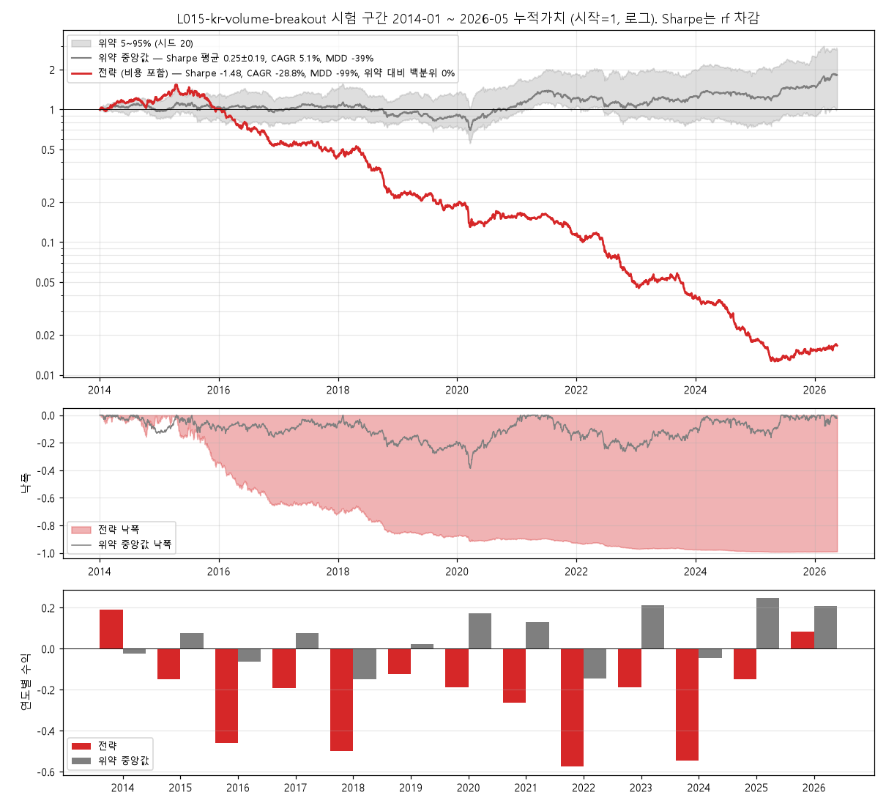

# L015 — KR 거래량 동반 돌파 (전고점·이평), 실패 즉시 손절, 다음 저항대 앞 익절

> 사용자 아이디어 "지지와 저항 전략"(2026-11-19)의 하위 전략 3/3. 원문 요지·겹침·공통 설정은 [L013 README](../L013-kr-ma-support/README.md) 0절과 같다.
> 세 lab(L013·L014·L015)은 같은 날 같이 사전등록했다.

## 0. 사용자 원문 (이 하위 전략)
- 전고점·이평 돌파 자리에서 **거래량이 받쳐 주며** 돌파하면 매수, **실패하면 바로 매도**, 성공하면 **다음 저항대 근처에서 매도**. 손익비 3:1 이상만.

### 겹침 — 엄격히 볼 것
- L003(rejected)은 같은 개발 구간에서 **200일선 상향 돌파**(KR 12,028건, 20봉 초과수익 −0.39%로 반대 방향), 50/200 골든크로스(반대 방향),
  추세선 돌파, 쌍바닥 사이 고점 돌파를 봤다 → 모두 통과 0. 이 lab의 돌파 신호 일부(240일선 돌파)는 L003 200일선 돌파와 거의 같은 사건이다.
  `trials.exposed_from: [L003]`. validator는 경계선 결과를 보류 쪽으로 본다.
- 새로 보는 것: **거래량 2배 확인**, 전고점(60봉) 돌파, 돌파선 바로 아래 손절(실패 즉시 청산), 다음 저항 목표와 3:1 필터.
  L003은 고정 20봉 보유 수익을 봤고 손절·목표 청산과 거래량 조건은 없었다.

## 1. 타겟 시장
- KR 주식 `krx_1d` 전체(상장폐지 포함) 중 그날 20일 평균 거래대금 ≥ 10억 원, 원본 종가 ≥ 1,000원, 245봉 이상 이력 / 일봉. US는 [us/](us/) 참고만.

## 2. 전략 — 백테스트 실행 전에 작성하고 커밋
- 작성일: 2026-11-19
- **가설**: 저항선(전고점·긴 이평)에는 본전 매도 물량이 쌓여 있다. 평소의 2배 이상 거래량으로 이 물량을 소화하며 종가로 넘어서면 공급이 줄어
  다음 저항까지 가격이 움직이기 쉽다(정보를 가진 쪽의 매수가 거래량으로 드러남). 돌파가 가짜면 곧 선 아래로 돌아오므로 손절이 짧고 분명하다.
- 반대 가설: KR에서 돌파 뒤 수익은 평균 회귀로 오히려 음수(L003 200일선 돌파 −0.39%)이고, 거래량 급증은 개인 추격 매수의 정점을 표시한다.
- 출처: 오닐(CAN SLIM)의 거래량 동반 돌파, 리버모어 피벗 포인트, 고전 지지·저항.
- 진입 규칙 (봉 t 종가까지 보고, t+1 시가 진입):
  1. 돌파선 후보: 직전 60봉(t 제외) 고가 최대(전고점), 60·120·240일 이평. 종가 > 선 이고 전일 종가 ≤ 그 선(이평은 전일 이평과 비교)인 것 중 가장 높은 선.
     (5·10·20일선은 하루걸러 넘나들어 "돌파"로 보지 않는다 — 사전 결정.)
  2. 거래량 ≥ 직전 20봉 평균 거래량 × 2.0, 양봉(종가 > 시가).
  3. 손절(돌파 실패) = 돌파선 × 0.98.
  4. 목표 = 종가 위 가장 가까운 다음 저항 × 0.995. 저항 후보 = 종가 위의 이평(5~240), 직전 250봉 고점.
     위에 저항이 없으면(1년 신고가 영역) 목표 = 종가 + 3.0 × (종가 − 손절) (정확히 3R).
  5. 손익비 ≥ 3.0. 같은 날 20일 평균 거래대금 순 상위 5개.
- 청산 규칙: 손절가·목표가만 (같은 봉 둘 다면 손절, 갭은 시가). 시간 청산 없음.
  "실패 시 바로 매도"는 장중 손절가 도달로 근사한다 (종가 확인 뒤 다음 날 매도보다 빠르고, 장중 일시 이탈에도 잘린다).
- 실행 유형: `type: trade`. 학습(`fit`) 없음.
- 포지션 크기: L013과 같음.
- 파라미터: `lab.yaml` `params`.

### 비교 기준 (사전등록)
L013과 같음 — 무작위 종목 위약(`placebo.py`, 시드 20) 대비 백분위. 판정은 고정 기준 7개로만.

### 예측 먼저 (결과를 보기 전에 기록, 2026-11-19)
- **lead agent (Claude)**: 고정 기준 1 **불통과** (확신 85%). 시험 Sharpe −0.3 ~ +0.3, 승률 18~26%, 위약 대비 백분위 20~60%.
  근거: L003 KR 이평 돌파가 반대 방향이었고, 거래량 급증은 KR 소형주에서 테마성 단기 고점과 겹친다. 손절이 돌파선 2% 아래라 갭 하락에 −1R보다 크게 잃는 일이 잦을 것.
- **사용자**: (결과 전에 받지 못함 — 사용자가 결과를 먼저 봄. 예측 기록 없음)

## 3. 백테스트 (워크포워드)
- 시도 횟수: `lab.yaml` `trials`, `exposed_from: [L003, L011]`.
- 실행 계획 (사전등록): 시도 1회 = `uv run python -m autotrader.backtest.lab labs/L015-kr-volume-breakout`(±20% 민감도 포함, `--quick` 아님) + `placebo.py`(시드 20).
  결과를 보고 규칙을 바꾸면 그것은 새 시도이고, 이 작업 범위에서는 하지 않는다 (사용자·전략부 HQ 결정).
- 개발 구간: 2011-01-01 ~ 2026-05-18. 학습 36개월 → 시험 6개월, 첫 시험 창 2014-01.
- 비용: 엔진 기본값, 비용 2배 자동.
- 결과 요약 (실행 2026-11-19, 결과 `results/20261119-220122/`, 위약 `results/placebo-20261119-222215.json`):

  | 항목 | 값 | 기준·비고 |
  |---|---|---|
  | 시험 구간 | 2014-01-02 ~ 2026-05-18 (시험 창 25개) | 잠금 구간 안 열었음 |
  | 시험 Sharpe (비용 포함, rf 차감) | **−1.48** (rf 안 뺀 값 −1.38) | 기준 ≥ 1.0, 높을수록 좋음 |
  | 학습 Sharpe 평균 | −1.71 | |
  | 비용 없을 때 / 비용 2배 | Sharpe −1.22 (총수익 −97%) / −1.82 (−99%) | 비용 문제가 아님 |
  | 총수익 / 연복리 / 최대 낙폭 | **−98%** / −28.8% / −99% | 자본 1,000만 원 |
  | 거래 수 / 승률 / 평균 R / 손익비 | 3,095 / 19.0% / −0.35R / 3.42 | 손익분기 승률 약 23% |
  | 평균 보유 / 기말 미청산 | 8.4봉 / 1건 | |
  | 민감도 ±20% (수치 파라미터 9개 × 2 = 18개, 목록형 이평은 고정) | Sharpe −1.77 ~ −1.19 | 모두 크게 음수 |
  | 위약 (무작위 종목, 시드 20) | 위약 평균 **+0.25** (표준편차 0.19), 전략 백분위 **0%** | 같은 손절·목표 거리의 무작위 종목보다 확실히 나쁨 |
  | 국면별 Sharpe | 상승 −0.93 / 하락 −2.38 / 혼조 −1.21 | 모든 국면에서 손실 |
  | 시험 창 25개 Sharpe | −4.63 ~ +1.69, 양수 10개 | |

- 예측 대비: 불통과는 맞았고, Sharpe(예측 −0.3 ~ +0.3)와 위약 백분위(예측 20~60%)는 예측보다 훨씬 나빴다.
- **이상치 점검 (−98%가 버그·체결 모형 탓인지, 원본 일봉 `krx_1d`와 3,095건 전부 대조)**:
  - 상한가 시가 진입 3건(0.1%), 상한가에 잠긴 날 진입 0건. 신호봉이 상한가 근처였던 건 403건(13%, 평균 −0.17R)으로 오히려 평균보다 덜 나쁨.
  - 하한가 터치 날 손절 26건(0.8%, 손익 −179만 원 / 전체 −983만 원), 하한가에 잠긴 날 손절 0건.
  - 같은 봉에서 손절·목표 둘 다 닿아 손절 처리 32건(1.0%, −22만 원).
  - **손실 원인은 진입 당일 손절**: 871건(28%), 평균 −1.33R, 합계 −1,017만 원(전체 손실보다 큼). 진입 당일 청산(손절·목표 965건)을 빼면 나머지 평균 −0.04R, 당일 손절만 빼면 +0.03R(validator 재집계) — 둘 다 약 0.
    다음 날 시가가 2% 넘게 갭하락한 진입 499건은 평균 −0.88R, 61%가 당일 손절. 신호봉 상승폭이 클수록 평균 R이 나쁨(5% 미만 −0.30R → 20% 이상 −0.46R).
  - 결론: 엔진·데이터 문제가 아니라 KR 거래량 동반 돌파 다음 날의 되밀림(단기 반전)이 원인. L003의 KR 200일선 돌파가 반대 방향이었던 것과 같은 방향.
  - (엔진은 거래정지(거래량 0)는 `tradable`로 막고, 상·하한가 미체결은 모형에 없다 — 위 집계상 영향 작음.)

### 3-2. 비교 그림 (시각화 — 시도로 세지 않음)

- 대조군: 사전등록한 무작위 종목 위약(시드 20) — 같은 날·같은 손절/목표 비율 거리로 그날 유니버스의 다른 종목에 진입. 회색 띠는 시드 20개 누적가치의 5~95%, 회색 선은 중앙값.
  위: 누적가치(로그, 시작=1, 범례에 Sharpe(rf 차감)·CAGR·MDD) / 가운데: 낙폭 / 아래: 연도별 수익.
- 새 백테스트 없음: 전략 곡선은 lab 실행이 남긴 `test_returns.parquet`, 위약 곡선은 `placebo.py`를 원래 실행 날짜·같은 시드로 재생(시드별 Sharpe가 json과 다르면 멈춤).
- 다시 그리기: `uv run python labs/L015-kr-volume-breakout/plot.py labs/L015-kr-volume-breakout` (US 참고: 끝을 `labs/L015-kr-volume-breakout/us`로 → [us/chart.png](us/chart.png)).

## 4. 유효성 검증 (labs/README.md의 고정 기준)
- [ ] 1. 시험 구간 Sharpe ≥ 1.0 — **불통과** (−1.48)
- [ ] 2. 시험 Sharpe ≥ 학습 Sharpe × 0.5 — **불통과** (학습 Sharpe −1.71 ≤ 0)
- [ ] 3. 파라미터 ±20%에서 Sharpe ≥ 0.5 — **불통과** (최저 −1.77)
- [ ] 4. 비용 2배에서도 수익 — **불통과** (총수익 −99%)
- [x] 5. 거래 수 ≥ 30 — 통과 (3,095)
- [ ] 6. 잠금 구간 — 이 작업에서는 열지 않음 (기준 1~4 불통과)
- [ ] 7. 생존편향·미래참조 점검 — 생존편향 없음(`krx_1d` 상장폐지 포함), 미래참조 자동 검사 통과(3시점 자르기 불일치 0). validator 확인 대기.
- 노출: KR 개발 구간은 고전 퀀트 프로그램이 이미 15회 이상 봤다 — 이 결과는 경계선이 아니라 영향 없음.

## 5. US 참고 실행 ([us/](us/)) — 생존편향, 판정 근거 아님. 시도는 따로 센다.
- 결과 `us/results/` 최신: 시험 Sharpe 0.38 (학습 0.56), 비용 없을 때 0.68, 비용 2배 0.10(총수익 +33%), 총수익 +109%, 최대 낙폭 −24%, 거래 831, 승률 29.7%,
  민감도 0.08 ~ 0.50, 위약 평균 0.49 → 전략 백분위 30%. KR과 달리 손실은 아니지만 위약(무작위 종목)보다 낮고, 생존편향이 있는 데이터다.

## 미리 알려진 한계
- 시간 청산 없음, 일봉 손절 우선, 1회 주문 상한 미적용 (L013과 같음).
- 거래량은 `krx_1d` 원 거래량(분할 보정 여부 미확인) — 분할일 전후 20일 평균과 비교가 왜곡될 수 있다. 영향은 소수 사건.

## 판정
- validator 의견서: [validation.md](validation.md) — **기각 권고** (기준 1~4 크게 불통과, 위약 20개보다 모두 나쁨, −98%는 엔진 버그가 아니라 진입 당일 되밀림·갭하락).
- 결과: (사용자가 정한다)
